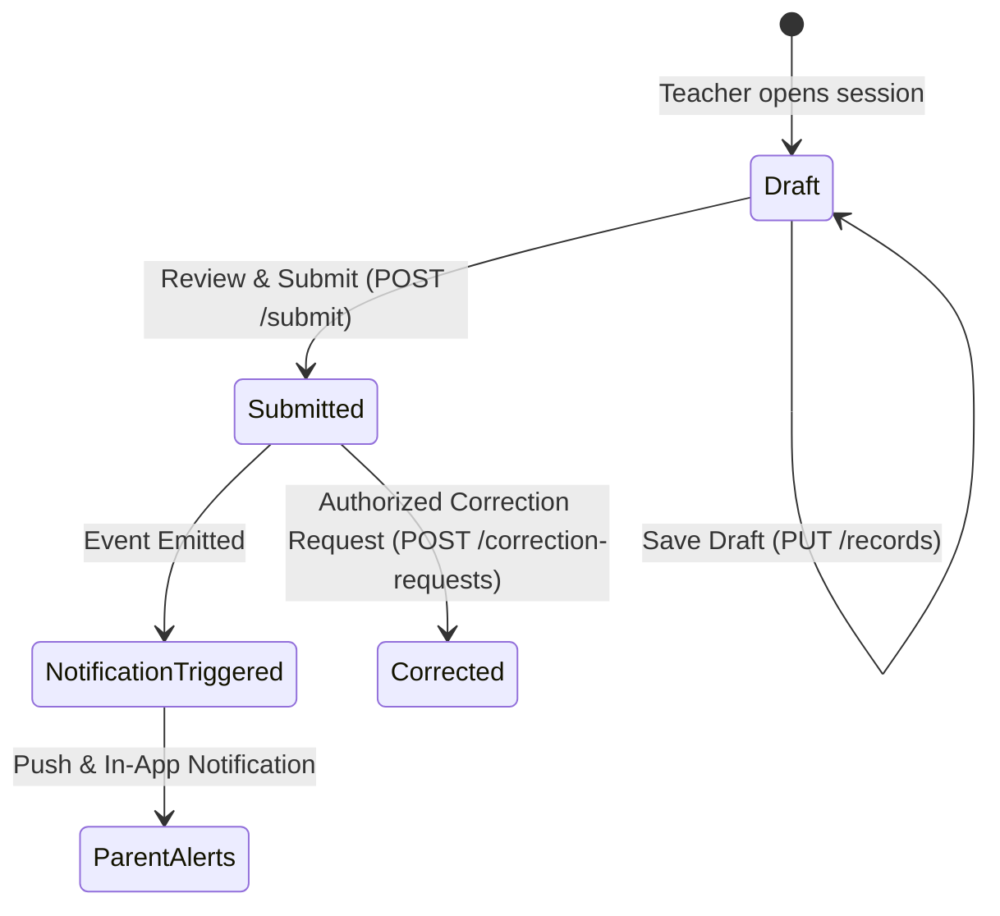

# EduTrack Architecture & System Design Document

## 1. System Overview

EduTrack is an enterprise-grade School Attendance Management System designed to handle attendance workflows, reporting, role-based access control, leave management, and automated notifications for educational institutions.

The system connects four distinct roles:
1. **School Administrators**: Global oversight, academic structure configuration, user lifecycle management, audit reviews, and compliance reporting.
2. **Teachers & Faculty**: Classroom roster access, roll call marking (Present, Absent, Late, Excused), draft persistence, attendance finalization, and correction requests.
3. **Parents & Guardians**: Linked student visibility, multi-child switcher, attendance calendars, instant absence alerts, and student leave request submission.
4. **Students**: Self-service attendance percentage tracking and announcement viewing.

---

## 2. Monorepo Structure

```
school-attendance/
├── apps/
│   ├── web/                    # React 18, Vite, Tailwind CSS, TanStack Query, React Hook Form, Recharts
│   └── mobile/                 # React Native, Expo SDK 51, Expo Router, Native UI
├── services/
│   └── api/                    # Node.js, Express.js, TypeScript, Mongoose ODM, Swagger OpenAPI
├── packages/
│   ├── shared-types/           # Common TypeScript interfaces, DTOs, and domain models
│   └── validation/             # Reusable Zod schemas for request validation across platforms
├── docs/                       # Architectural docs, API references, deployment playbooks
├── tests/                      # Automated test suite (Vitest + Supertest)
└── .github/workflows/          # CI/CD pipelines
```

---

## 3. Data Model & Collection Indexing

### Users
- `_id`: ObjectId
- `email`: Indexed, Unique, Lowercase
- `role`: Enum (`admin`, `teacher`, `parent`, `student`)
- `isActive`: Boolean, Indexed
- `passwordHash`: Bcrypt hash (cost 10)

### AttendanceSessions
- `_id`: ObjectId
- `classId`: Ref to Class, Indexed
- `date`: String (YYYY-MM-DD), Indexed
- `period`: Number (1..12)
- `subjectId`: Optional Ref to Subject
- `status`: Enum (`draft`, `submitted`, `corrected`)
- `markedBy`: Ref to User
- **Compound Unique Index**: `{ classId: 1, date: 1, period: 1, subjectId: 1 }` (guarantees idempotency and prevents duplicate sessions).

### AttendanceRecords
- `_id`: ObjectId
- `sessionId`: Ref to AttendanceSession, Indexed
- `studentId`: Ref to Student, Indexed
- `status`: Enum (`present`, `absent`, `late`, `excused`)
- `markedAt`: Date
- `updatedBy`: Ref to User
- `remarks`: Optional String
- **Compound Unique Index**: `{ sessionId: 1, studentId: 1 }` (guarantees a student is recorded at most once per session).

---

## 4. Attendance State Machine & Correction Policy



1. **Draft Stage**: Teacher can adjust statuses, notes, and save intermediate progress. No parent alerts are sent.
2. **Submission**: Atomic batch persistence stamps `submittedAt` and changes session status to `submitted`. Submitted sessions are locked against direct overwrites.
3. **Absence Event Dispatch**: Background event engine queries verified parent links for all absent students and queues push alerts with deduplication safeguards.
4. **Correction Window**: Teachers can submit corrections within the policy window (configurable, default 2 days). Changes are logged in the immutable `AuditLog` collection.
